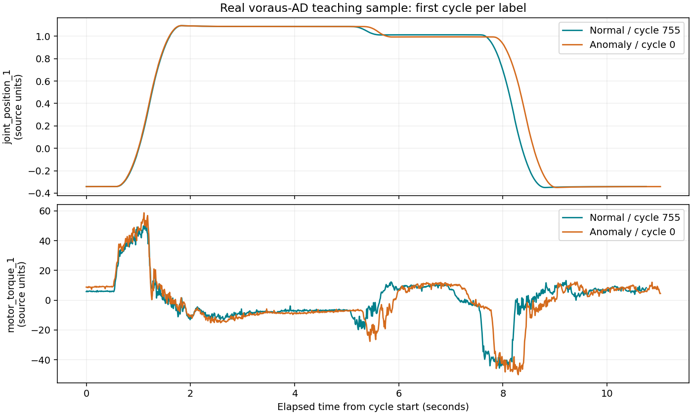

# 로봇 공정 이상탐지 — 제조·로봇 프로젝트 시작

2026-10-13 사용자가 제조업과 로봇을 연결하는 프로젝트부터 시작하기로 했다. 첫 질문은 로봇이 물체를 집어 옮기는 동안 센서 기록을 보고 정상과 이상을 구분할 수 있는가이다. 로봇 정책 학습·실패 복구는 이후 별도 실험으로 연결한다.

## 오늘 실제로 준비한 것

[voraus-AD 공식 저장소](https://github.com/vorausrobotik/voraus-ad-dataset)의 100 Hz Parquet에서 일곱 열만 읽었다. 원본 1,115,942,833바이트 중 총 36,439,233바이트의 HTTP 범위를 전송했고, 작업 네 번의 기록 4,330행만 로컬 CSV로 남겼다. 전체 파일을 디스크에 받지 않았다. 새 패키지를 설치하지 않고 기존 NumPy·requests·PyArrow 22.0.0·matplotlib을 사용했다.

| 작업 ID | 데이터셋 정답 | 공식 category 코드 | 행 수 | 기록 길이 |
|---|---|---|---:|---:|
| 755 | 정상 | 12: NORMAL_OPERATION | 1,069 | 약 10.75초 |
| 756 | 정상 | 12: NORMAL_OPERATION | 1,055 | 약 10.61초 |
| 0 | 이상 | 0: AXIS_FRICTION | 1,096 | 약 11.03초 |
| 1 | 이상 | 0: AXIS_FRICTION | 1,110 | 약 11.17초 |

유형 코드는 [공식 데이터 로더](https://github.com/vorausrobotik/voraus-ad-dataset/blob/main/voraus_ad.py)의 Category 정의로 확인했다. 처음 두 ID씩 선택한 편향된 학습 표본이며 평가용 분할이 아니다. 정상 setting 72와 이상 setting 0은 다른 작업 조건이다. 서로 통제된 짝 실험이라고 해석하지 않는다.

첫 공부는 [LESSON-01.md](LESSON-01.md)에 있다. 아래 그림은 실제 정상 755번과 이상 0번의 첫 관절 위치·모터 토크를 같은 시간 축에 겹친 것이다.



신호는 원본 단위 값으로 보존했다. 위치의 rad/degree 또는 토크 단위를 확인하기 전에는 변환·단위 단정을 하지 않는다. 곡선만 보고 마찰의 물리적 원인이나 고장 위치를 새로 판정하지 않는다.

## 실행

저장소 루트에서:

```powershell
python projects/robot-process-health/test_starter.py
python projects/robot-process-health/starter.py
```

첫 실행은 작은 행 묶음으로 공식 파일의 메타데이터와 선택 열을 읽고, 다음 실행부터 로컬 CSV의 SHA-256을 확인하여 재사용한다. 서버의 정확한 HTTP 206 범위·파일 크기·고정 ETag를 검사하며 요청 한 번 16MB, 전체 50MB의 한도를 넘으면 중단한다. 일부 조건이 바뀌면 전체 파일 다운로드로 우회하지 않는다. 전체 원본의 체크섬을 검증한 것은 아니다.

- `data/sample.csv`, `data/provenance.json`: Git에서 제외한 원본 표본·범위/해시 기록.
- `reports/first-10-rows.csv`: 처음 열 행의 실제 읽기 예제.
- `reports/data-check.json`: 검증된 작업 수·길이·표본 조건.
- `reports/sample-signals.png`: 실제 신호 그림.

## 다음 작은 목표

1. 사용자가 CSV 한 행을 읽고 time/sample/위치/토크의 의미를 설명한다.
2. 같은 작업에서 값이 시간에 따라 어떻게 바뀌는지 확인한다.
3. 그다음 작업 사이 변동과 데이터 분할을 설계한다. 같은 작업의 창을 학습·테스트에 섞지 않는다.
4. 충분한 정상 fit/calibration 기록을 확보한 후 단순 기준 방법과 모델을 비교한다. 정답·category·setting·sample 번호는 이상 판정 입력에서 제외하고 해석/분할에만 사용한다.

아직 모델 학습·이상 감지 시점 평가·로봇 제어·재시도 실험을 하지 않았다. 이상 라벨은 전체 작업 단위이며 모든 순간이 이상이라는 뜻이 아니다. 감지 시점의 정답이 없는 상태에서 조기 감지 시간을 만들어 쓰지 않는다. 사용자가 직접 실습을 마쳤다고 기록하지 않는다.

데이터와 파생 표·그림: [CC BY-NC-SA 4.0](https://creativecommons.org/licenses/by-nc-sa/4.0/), 출처 voraus robotik 및 Brockmann 등. 논문: [The voraus-AD Dataset for Anomaly Detection in Robot Applications](https://arxiv.org/abs/2311.04765). 외부 공식 코드는 실행하지 않았고 공개 데이터만 기존 라이브러리로 읽었다.
